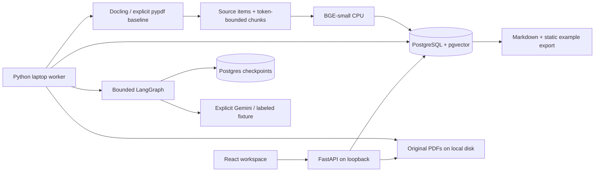

# Architecture and boundaries

The API performs short relational work and bounded file storage. Parsing, indexing and
research run in a different process, not BackgroundTasks. Query embedding currently
runs locally in the API for retrieval inspection; this loads BGE into that process.
It is documented as a Mode C blocker rather than pretending the API is already slim
in RAM. A future measured design could enqueue query encoding or use a lightweight
CPU inference runtime. No managed compute or generative-model download is required.

## Data flow and immutability
Collections have local owner IDs. A paper is identified by collection/title; use the
same title for a new version. Version identity includes paper, SHA-256 and parser /
chunk / model configuration. Original bytes are addressed by SHA-256, independently
of their display names. Parsing artifact files are separate from PDF bytes, vectors,
SQL data, extraction caches and graph checkpoints. A document version cannot be
rewritten under an existing report. Runs freeze ready version IDs and processing
identities. The latest ready version per paper is selected at submission, so failed
versions do not hide a previous usable source. Partial ingestion failure does not
stop other jobs. Duplicate reupload returns the existing version/job.

A custom greedy item-aware chunker preserves Docling headings, source item IDs and
available boxes; tables export as Markdown and oversized tables split with original
item references. Chunks target 420 tokens using the actual BGE tokenizer; heading
prefix and special tokens count toward the 512-token window. Overlong headings remain
in metadata but use a short embedding prefix. No overlap is the initial hypothesis:
neighbor/context retrieval compensates for missing local context. This is a simple
alternative to HybridChunker, not a claim of superiority; measure recall/layout quality
before changing it. Word reflow normalizes whitespace; quotations match normalized
stored source text. Scans with insufficient embedded text fail explicitly; no OCR.

Postgres `ts_rank_cd` ranks English FTS matches; exact cosine ranks compatible 384D
vectors. RRF uses constant 60 and rank lists capped at 80, then source-text deduplication
and a configurable per-paper cap. None are confidence probabilities. Frozen version
restrictions are applied before both ranking branches. No ANN index is needed yet.

## Dispatch versus graph persistence
Jobs track dispatch ownership and retry time; LangGraph checkpoints track in-run
progress. `claim()` uses SKIP LOCKED to serialize competing claims. Heartbeats renew
leases in a separate thread during CPU/model work. A transaction calls `fence()` before
writing job/run artifacts; lease expiry or ownership loss invalidates that owner.
A per-run session advisory lock also serializes graph invocations across the gap
between returning a fenced node and saving its checkpoint. A replacement waits for
the prior session without consuming the failure retry budget or issuing model calls.
Session closure releases the lock. Transaction pooling is unsupported for this path.
Retries are at most three job attempts, with bounded backoff. A run can be explicitly
resumed from a quota/configuration pause. Exhausted abandoned jobs become failed.

At least once dispatch implies operations need idempotence. Stable passage IDs derive
from document-version UUID and ordinal. Unique constraints prevent duplicate indexing.
Role artifacts upsert by run/role; validated model responses cache by run/model/prompt
input/schema/settings. A cache hit can repair a checkpoint-write crash without a second
external call. Extraction cache also keys the exact processing manifest and input;
reuse is conservative. It is not a promise that every extraction will be shared.

There is an unavoidable window between sending an external request and persisting the
response. Persist a pending call and reserve budget before I/O. An ambiguous outcome
pauses, never silently repeats; explicit acknowledgement may duplicate quota usage.
Model 429 pauses without provider/model/account fallback. Retry-After is retained as
a not-before time even when the owner requests resume. Unknown usage remains unknown
in the UI; internal conservative accounting is distinct from measured tokens.

Checkpoints and short job transactions use separate connections. Cancellation is
checked before tools, stages and completion. An ongoing provider request may finish.
Runs can continue without an API/browser connection, but the laptop must be online.

## Research modes
RAG: retrieve → one structured answer → report. Single: retrieve → one researcher
extraction/candidates → same-agent self-review → same-agent experiment proposals → report. Multi: retrieve →
lead plan → literature coverage/followups → methods matrix → lead candidate synthesis
and counter-search/context → skeptical review of every candidate/claim → experiments
for survivors → report. Five roles, six model stages; no fake parallel animations.

A role can abstain. Structured Pydantic outputs forbid extra fields; the Gemini wire
schema uses the SDK-supported subset, while full constraints are enforced locally.
Typed tools constrain collection, allowed versions, counts and query lengths. Tools
are Python allowlisted operations, not general execution capabilities. Findings and
operational events are stored; private chain-of-thought is neither requested nor saved.

Exact citation ID/quote validation prevents invented provenance, not unsupported
interpretation. Reviewer support judgments are separate from those checks. Matrix
numbers need source citations and retain conditions; unknown is the default. Candidate
survival is a configured provisional disposition, not independent scientific validation.

## Security
Local loopback binding, explicit origin allowlist, bounded upload size, no filename
path use, server-generated disk keys, no server URL import. PDF.js disables eval and
renders the exact requested page. Source regions use actual parser coordinates only;
no coordinates means honest text/page fallback. All document text is untrusted input.
Pydantic rejects unauthorized tool fields; graph code owns transitions and budgets.

Server-only provider keys and DB credentials are ignored by Git. Owner bearer token
is verified with constant-time comparison for data endpoints and all mutation requests.
Default local mode is a single trusted owner, not multi-tenant SaaS. Read-only rejects
all writes. Do not expose owner mode directly to the Internet or misrepresent local
ownership fields as a fully implemented multi-tenant authorization system.

## Operations
Back up PostgreSQL plus `.data/pdf` and `.data/parsed`; both are needed to navigate
old evidence. LangGraph schema is created by explicit setup, not request side effects.
Schema downgrades are intentionally destructive-review-only (restore a backup).
See LOCAL_SETUP.md, DEPLOYMENT.md, VERIFICATION.md and ADRs for decision rationale.
