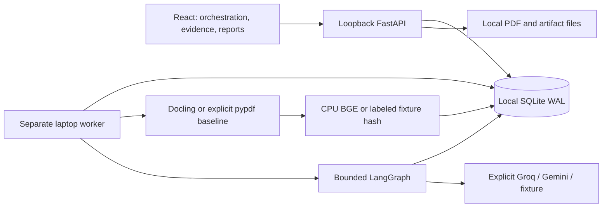

# Current architecture — SQLite + Groq

ADR 004 supersedes the original PostgreSQL/Gemini-first architecture by explicit user
request. SQLite is the real supported store, not a fallback used to simulate Postgres.

## Boundaries and ownership

The API validates and enqueues work. Upload requests store bounded PDF bytes and create
immutable version/job records; they never parse or generate research in a background
request task. The worker independently claims durable jobs, maintains its heartbeat,
parses/embeds locally and invokes the graph. API query embedding also runs locally and
requires BGE worker extras for semantic retrieval. SQLite and files stay on the same
local filesystem; the browser owns no privileged credentials or job execution.

The database holds collections, papers, immutable document versions, stable passages,
384D JSON vectors, run manifests/configuration, dispatch jobs, events, artifacts, model
call intents/responses, extraction cache and LangGraph checkpoint tables. PDFs and large
parsed artifacts remain files. A report freezes document versions, so re-ingestion cannot
silently change an old citation. Content hash plus parser/tokenizer/embedding identity
keys reusable processing artifacts. Fixture and real embedding identities cannot mix.

## SQLite transactions and recovery

Initialization creates schema version 1 and SqliteSaver tables in the same file. WAL,
foreign keys, FULL synchronous and a bounded busy timeout apply. Read helpers open short
read connections; write contexts explicitly BEGIN IMMEDIATE before count/check/claim
reads. One writer executes at a time. Unique constraints and fenced transactions protect
idempotent ingest, paper limits and dispatch ownership. No writer transaction spans CPU
parsing, embedding or provider network requests.

Job claims use an atomic update inside the write transaction. Leases expire if heartbeat
stops; every protected result write checks current owner/status/lease. Bounded retry
handles recoverable local failures. Cancellation is observed between steps; an in-flight
provider call can finish. A separate OS file lock per database/run covers graph invocation
and checkpoint commits, including the interval after a node returns. A stale owner cannot
race a replacement's checkpoints. Process death releases the OS lock. Supported hosts are
macOS/Linux; cross-host writers and network filesystems are outside this design.

Model call intent is committed before network I/O. Completed responses can be reused after
a crash. Unknown outcomes (including invalid/incomplete responses) pause for explicit
duplicate-quota acknowledgement instead of automatic re-sending. Unknown usage remains
conservatively charged. Known configuration rejection and 429 release the reservation;
429 stores a not-before time honored on explicit resume. No provider/account/model switch
occurs automatically. Runs freeze the provider model ID at creation.

## Retrieval and citations

FTS5 BM25 ranks literal Unicode query terms; no user text is interpolated into SQL or
interpreted as FTS operators. Query length/term count are bounded. Corpus/version filters
apply to keyword and vector branches. BM25's corpus statistics come from the database's
FTS index; only eligible rows are returned. Exact cosine scans eligible 384D vectors in
batches, retaining top 80 in a heap. Each branch contributes reciprocal ranks with k=60.
Then deduplication and paper diversity select the final context. Scores are rankings,
not confidence probabilities. This differs from the previous PostgreSQL ts_rank_cd path.

The chunker counts the actual BGE tokenizer, including heading/special tokens, targets
420 and refuses >512 inputs without silent truncation. Docling is CPU-only, OCR off;
source item IDs, page and boxes are retained. pypdf is an explicit layout-free baseline.
Evidence validation requires exact normalized quotes, manifest membership and retrieved
IDs. Matrix citations must match their paper. Evidence drawers render the actual PDF
page; highlight only real available coordinates. No boxes are invented for fixtures.

## Bounded research

Multi: retrieve → lead plan → literature (+ bounded followups) → methods → lead candidates
(+ counter-search/context) → skeptical review → experiment proposals → report. Six model
stages represent five personas, not parallel unrestricted agents. Single uses one persona
for extraction/self-review/proposals; RAG generates once. Typed tool and output contracts,
call/token/tool limits, cache identity and citation checks apply to all modes. Reviewer
must address every claim and candidate; only provisionally surviving candidates may
receive experiments. Agreement and corpus misses never establish universal novelty.

Groq is primary (120B default, explicit 20B alternative), using the official SDK, strict
wire schema and zero SDK retries. Full Pydantic/evidence constraints remain local.
Gemini is secondary; fixture is explicit and deterministic. No key is shipped. Account
free-plan/billing/quota verification remains the owner's responsibility before live use.

## Deployment and limitations

Public static example + private laptop research is supported. The showcase uses original
synthetic documents and recorded fixture data; walkthrough never starts an LLM call.
SQLite on a laptop cannot coordinate with a separate hosted API through a shared DB file.
A future public live service needs a deliberate remote coordination/storage design.
Back up the database consistently with SQLite backup plus coordinated PDF/artifact copies.
Real model assets, live provider quality and realistic full-corpus performance remain
separate verification items; small synthetic controls do not measure those properties.
